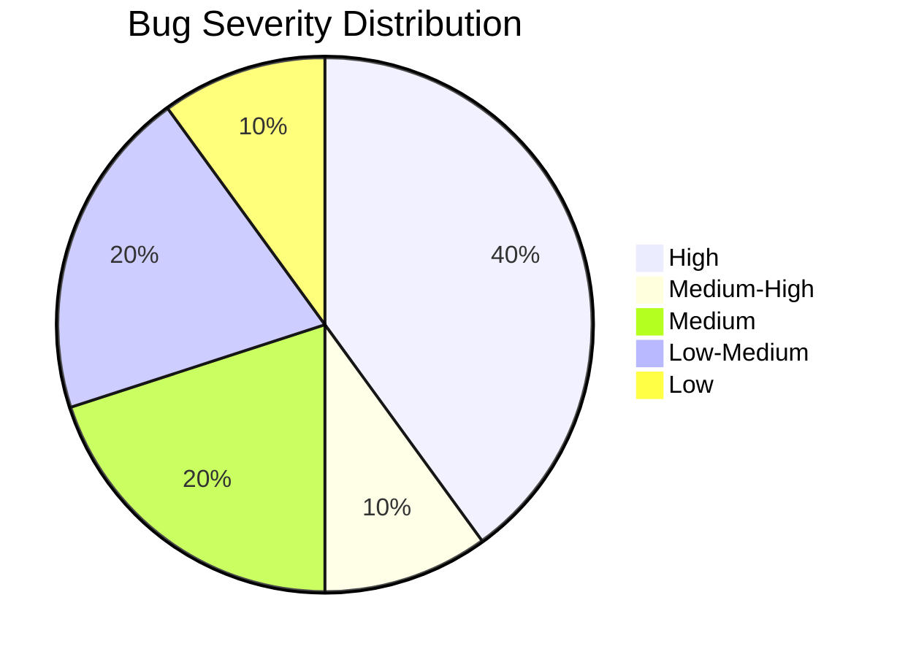
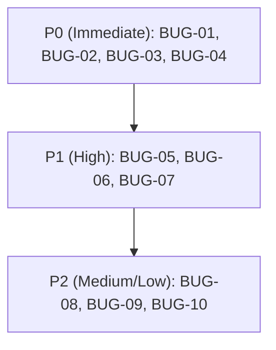

# Invisible Work Detector — Comprehensive Bug & Vulnerability Report

**Date**: November 15, 2026  
**Environment**: Windows 11, Python 3.13.2, FastAPI, SQLite WAL, Vite + React 19  
**Repository**: [dev2](file:///c:/Users/varan/OneDrive/Desktop/dev2)  
**Test Suite**: 39 Unit/Integration Tests (pytest), 2 End-to-End Tests (Playwright), Ruff Linter  

---

## Resolution — November 15, 2026

All ten findings have been reviewed and addressed. The findings below are the original report; this table records the resulting changes.

| ID | Resolution |
| --- | --- |
| BUG-01 | Filename substitution replaces forbidden characters in invoice numbers with hyphens. Original extracted and Excel values are preserved; literal template paths are still rejected. |
| BUG-02 | Rejected batches are split to isolate invalid events. Only successful deliveries or individually rejected events leave the outbox; rejections are counted. Lost responses retry idempotently, and lease/authentication/connection failures retain pending events. |
| BUG-03 | An out-of-scope previous identity falls back to a creation inside the approved folder. |
| BUG-04 | Unavailable roots are skipped and availability is rechecked on each sync, including when all roots are missing. Monitoring resumes when roots return. |
| BUG-05 | Enqueue and claim recover stale running commands immediately into `needs_review`, without replaying them. |
| BUG-06 | **Report correction:** HTTPX explicitly supports sharing a Client across threads. Heartbeats now use a separate client/pool, and shutdown waits for the heartbeat thread before closing clients. |
| BUG-07 | Workbooks without dimensions use a streaming row count. Empty and populated workbooks validate; a full sheet still fails with an actionable error. |
| BUG-08 | Invoice dates accept optional colons while retaining invoice-date precedence over due dates. |
| BUG-09 | Status and lease checks interpret legacy naive timestamps as UTC; malformed timestamps count as offline. |
| BUG-10 | Pytest's cache provider is disabled to avoid checkout cache writes and OneDrive cache-access warnings. |

Regression coverage: `tests/test_bug_regressions.py` and `tests/test_launcher.py`. Python validation: **76 passed, 1 skipped** (Windows symlink permission unavailable); Ruff passed. The remaining test warning is an existing Starlette/HTTPX deprecation, unrelated to cache access.

Frontend validation: production build passed; **3 Playwright end-to-end tests passed** using Microsoft Edge at `http://127.0.0.1:8765`. Desktop (1440×1000) and mobile (390×844) checks covered pairing, sample activity, filters, dialogs, and layout. The real-agent flow verified monitoring → discovery → preview → approval → execution → history → pause, with no browser errors. A status regression test verified enabled/waiting → observing → paused. Existing screenshots confirmed meaningful content without a framework error overlay. The Browser plugin was unavailable, so validation used the repository's Playwright workflow.

Follow-up: monitoring could remain labeled paused while a large or synced folder's initial metadata scan blocked the agent loop. Indexing now runs on a cancellable background thread with a captured scope; cancelled scans cannot contaminate a new scope's index. Monitoring, event delivery, and permission changes stay responsive. The dashboard distinguishes paused monitoring from enabled monitoring waiting for folders and polls the latter more frequently. After restarting the local app, its live status reported two watched folders, monitoring enabled, and no agent error.

---

Follow-up: repeated startup on port 8000 caused Windows error 10048 while the existing app was healthy. The launcher now reserves the socket before initializing storage or an agent, recognizes an existing app through its public health check, and exits successfully with the dashboard URL. Unrelated port owners produce an actionable error. The exact `scripts/start.ps1` command was verified against the running local app; isolated tests also cover normal startup and duplicate launches without disturbing the first server.

## Original Executive Summary

A comprehensive source code review and dynamic testing of the **Invisible Work Detector** codebase was conducted. The project demonstrates strong architectural principles (e.g., local loopback binding, HttpOnly session cookies, atomic SQLite transactions, and immutable preview-approval execution guarantees). 

However, deep inspection revealed **10 concrete bugs and reliability flaws** spanning filesystem edge cases, regex and template rendering failures, thread safety violations in the desktop agent, data loss during batch event transmission, and unhandled 500 exceptions during Excel workbook validation.

### Severity Breakdown


| ID | Issue | Severity | Component | Impact |
| :--- | :--- | :---: | :--- | :--- |
| **BUG-01** | [Slashes in invoice number break default filename template and preview](#bug-01-slashes-in-invoice-number-break-default-filename-template) | **High** | Automation / Executor | Breaks core invoice automation preview |
| **BUG-02** | [Outbox batch rejection permanently drops up to 100 valid events](#bug-02-outbox-batch-rejection-permanently-drops-up-to-100-valid-events) | **High** | Desktop Agent / Backend | Silent data loss and agent watcher crash |
| **BUG-03** | [`Watcher.created_event` drops file creations when previous identity is out of scope](#bug-03-watchercreated_event-drops-file-creations-when-previous-identity-is-out-of-scope) | **High** | Desktop Agent / Watcher | Legitimate file events dropped from monitoring |
| **BUG-04** | [`Watcher.sync` halts all monitoring if any approved folder is missing or deleted](#bug-04-watchersync-halts-all-monitoring-if-any-approved-folder-is-missing-or-deleted) | **High** | Desktop Agent / Watcher | Single missing folder breaks entire watcher |
| **BUG-05** | [Stale `running` command locks out new automations after agent disconnect](#bug-05-stale-running-command-locks-out-new-automations-after-agent-disconnect) | **Medium-High** | Backend Service | User blocked from running automations |
| **BUG-06** | [Concurrent non-thread-safe `httpx.Client` usage across heartbeat and worker threads](#bug-06-concurrent-non-thread-safe-httpxclient-usage-across-threads) | **Medium** | Desktop Agent / Client | Connection pool corruption & socket race conditions |
| **BUG-07** | [Unhandled `TypeError` (HTTP 500) in `validate_workbook` when `max_row` is `None`](#bug-07-unhandled-typeerror-http-500-in-validate_workbook-when-max_row-is-none) | **Medium** | Automation / Executor | HTTP 500 server crash on Excel validation |
| **BUG-08** | [Mandatory colon in `invoice_date` regex misses non-colon invoice formats](#bug-08-mandatory-colon-in-invoice_date-regex-misses-non-colon-invoice-formats) | **Low-Medium** | PDF Extraction | Date extraction failure on standard invoice layouts |
| **BUG-09** | [Naive datetime in `agent_status` causes `TypeError` crash](#bug-09-naive-datetime-in-agent_status-causes-typeerror-crash) | **Low-Medium** | Backend Service | Crashes status and dashboard queries |
| **BUG-10** | [Pytest cache access denied warning on OneDrive synced environments](#bug-10-pytest-cache-access-denied-warning-on-onedrive-synced-environments) | **Low** | Tests / Tooling | Noisy test execution warnings |

---

## Detailed Bug Findings

### BUG-01: Slashes in Invoice Number Break Default Filename Template
- **File**: [executor.py](file:///c:/Users/varan/OneDrive/Desktop/dev2/agent/executor.py#L77), [executor.py](file:///c:/Users/varan/OneDrive/Desktop/dev2/agent/executor.py#L126-L132), [WorkflowReview.tsx](file:///c:/Users/varan/OneDrive/Desktop/dev2/frontend/src/components/WorkflowReview.tsx#L44)
- **Severity**: **High**
- **Description**: 
  The regex in `invoice_fields()` explicitly extracts invoice numbers that include forward slashes (`/`), which are ubiquitous in billing (e.g., `INV/2026/001`):
  ```python
  r"(?im)\binvoice\s*(?:number|no\.?|#|id)\s*[:#-]?\s*([A-Za-z0-9][A-Za-z0-9_/-]{0,80})"
  ```
  Meanwhile, the React frontend pre-populates the default template in `WorkflowReview.tsx`:
  ```typescript
  new_name: invoice ? 'Invoice_{invoice_number}.pdf' : ''
  ```
  When the user submits the form to `/api/preview`, `render_filename()` resolves the template to `Invoice_INV/2026/001.pdf` and passes it to `safe_filename()`:
  ```python
  re.search(r'[<>:"/\\|?*\x00-\x1f]', name)
  ```
  Because `/` is a forbidden path separator, `safe_filename()` raises:
  `ScopeError: The naming template must produce one valid filename, without folders.`
- **Reproduction**:
  Run in Python:
  ```python
  from agent.executor import render_filename
  render_filename("Invoice_{invoice_number}.pdf", {"invoice_number": "INV/2026/001"})
  # Raises ScopeError
  ```
- **Remediation**:
  Sanitize `{invoice_number}` for filename templating in `build_plan` (e.g., replacing `/` and `\` with `-`), or provide a sanitized variable `{invoice_number_safe}`:
  ```python
  safe_invoice_number = re.sub(r'[/\\:]', '-', extracted.get("invoice_number", ""))
  values = {"stem": source.stem, "date": ..., **extracted, "invoice_number": safe_invoice_number}
  ```

---

### BUG-02: Outbox Batch Rejection Permanently Drops Up to 100 Valid Events
- **File**: [client.py](file:///c:/Users/varan/OneDrive/Desktop/dev2/agent/client.py#L201-L217), [service.py](file:///c:/Users/varan/OneDrive/Desktop/dev2/backend/app/service.py#L102-L134)
- **Severity**: **High**
- **Description**:
  In `agent/client.py`, the agent flushes events in batches of 100:
  ```python
  batch = self.outbox.batch()
  if batch:
      try:
          self.request("POST", "/api/events", json={"events": batch})
      except AgentAPIError as error:
          if error.status in {403, 422}:
              self.outbox.acknowledge(batch)
          raise
      self.outbox.acknowledge(batch)
  ```
  In `backend/app/service.py`, `record_events()` checks every event in the batch. If *any single event* fails validation (for example, if an event was created before a retention period reduction, or if a move was misclassified):
  1. `record_events()` throws `ServiceError(..., 422)` or `ScopeError` (403), rolling back the entire database transaction. None of the events are saved.
  2. The agent catches 422/403 and calls `self.outbox.acknowledge(batch)`, which deletes **all 100 events** from `agent.sqlite3`.
  3. The agent re-raises the error, which enters `except ...: self.watcher.close()`, killing the file watcher.
- **Reproduction**:
  Queue 5 valid events and 1 event with `timestamp < cutoff`. Run `record_events(batch)`. All 5 valid events are deleted from the outbox and 0 are recorded.
- **Remediation**:
  - In `backend/app/service.py`, filter out or skip events exceeding retention instead of failing the entire batch, or return accepted/rejected IDs.
  - In `agent/client.py`, do not acknowledge the entire batch on 422; retry valid events or prune only the offending item.

---

### BUG-03: `Watcher.created_event` Drops File Creations When Previous Identity Is Out of Scope
- **File**: [watcher.py](file:///c:/Users/varan/OneDrive/Desktop/dev2/agent/watcher.py#L168-L176), [watcher.py](file:///c:/Users/varan/OneDrive/Desktop/dev2/agent/watcher.py#L231)
- **Severity**: **High**
- **Description**:
  When Windows filesystem notifications represent a cross-folder move as a deletion followed by a creation, `Watcher.created_event()` looks up the file's inode in `self.deleted` or `self.locations`:
  ```python
  if previous:
      self.scope.check(previous)
      kind = "file_renamed" if Path(previous).parent == Path(destination).parent else "file_moved"
      return ActivityEvent(event_type=kind, old_path=previous, new_path=destination)
  return ActivityEvent(event_type="file_created", file_path=destination)
  ```
  If `previous` was outside the approved folder scope (e.g. an inode recycled from outside or a file moved from an unapproved folder), `self.scope.check(previous)` throws `ScopeError`.
  Because `created_event()` does not catch `ScopeError`, the exception propagates up to `on_any_event()`:
  ```python
  except (ScopeError, OSError, ValueError):
      return
  ```
  This causes the event handler to return early without emitting anything. The legitimate creation of `destination` in the approved folder is completely lost.
- **Reproduction**:
  Simulate an inode match where `previous = "C:/unapproved/old.txt"` and `destination = "C:/approved/new.txt"`. `on_any_event` emits 0 events.
- **Remediation**:
  Wrap `self.scope.check(previous)` in a `try...except ScopeError:` block. If `previous` is out of scope, fall back to returning `ActivityEvent(event_type="file_created", file_path=destination)`:
  ```python
  if previous:
      try:
          self.scope.check(previous)
          kind = "file_renamed" if Path(previous).parent == Path(destination).parent else "file_moved"
          return ActivityEvent(event_type=kind, old_path=previous, new_path=destination)
      except ScopeError:
          pass
  return ActivityEvent(event_type="file_created", file_path=destination)
  ```

---

### BUG-04: `Watcher.sync` Halts All Monitoring If Any Approved Folder Is Missing or Deleted
- **File**: [watcher.py](file:///c:/Users/varan/OneDrive/Desktop/dev2/agent/watcher.py#L42-L43), [client.py](file:///c:/Users/varan/OneDrive/Desktop/dev2/agent/client.py#L199), [paths.py](file:///c:/Users/varan/OneDrive/Desktop/dev2/shared/paths.py#L29-L30)
- **Severity**: **High**
- **Description**:
  In `Watcher.sync`:
  ```python
  roots = [approved_folder(value) for value in settings["approved_folders"]]
  ```
  `approved_folder()` raises `ScopeError("The approved folder must already exist.")` if a folder does not exist.
  If a user has 3 approved folders and one is renamed, deleted, or on an unplugged drive, `Watcher.sync()` throws `ScopeError`.
  In `Agent.run()`, this error is caught by `except ... as error: self.watcher.close()`. The watcher is closed and `watching` remains 0. Every 1-second iteration repeats the crash. Monitoring for all other valid approved folders is completely disabled.
- **Remediation**:
  In `Watcher.sync()`, skip or warn about non-existent folders rather than crashing:
  ```python
  roots = []
  for value in settings["approved_folders"]:
      try:
          roots.append(approved_folder(value))
      except ScopeError:
          continue
  ```

---

### BUG-05: Stale `running` Command Locks Out New Automations After Agent Disconnect
- **File**: [service.py](file:///c:/Users/varan/OneDrive/Desktop/dev2/backend/app/service.py#L371-L374), [service.py](file:///c:/Users/varan/OneDrive/Desktop/dev2/backend/app/service.py#L505-L511)
- **Severity**: **Medium-High**
- **Description**:
  `Service.enqueue()` enforces that only one run is in flight:
  ```python
  if conn.execute("SELECT 1 FROM runs WHERE status IN ('queued','running') LIMIT 1").fetchone():
      raise ServiceError("Another automation is in progress. Wait for it to finish.")
  ```
  However, `enqueue()` does not invoke `self.recover_stale_runs()`. If an agent process abruptly terminated during a run, that run remains in `running` status.
  `cancel_run()` also rejects cancelling any run that is not `queued`.
  Consequently, even after restarting the agent and waiting for the 90-second timeout, `enqueue()` continues to block any new automation until the user navigates to the Run History page (which calls `runs()` -> `recover_stale_runs()`) or waits for the 15-second background maintenance loop.
- **Remediation**:
  Call `self.recover_stale_runs()` at the top of `enqueue()` and `claim()`.

---

### BUG-06: Concurrent Non-Thread-Safe `httpx.Client` Usage Across Threads
- **File**: [client.py](file:///c:/Users/varan/OneDrive/Desktop/dev2/agent/client.py#L128-L133), [client.py](file:///c:/Users/varan/OneDrive/Desktop/dev2/agent/client.py#L145-L162), [client.py](file:///c:/Users/varan/OneDrive/Desktop/dev2/agent/client.py#L179-L184)
- **Severity**: **Medium**
- **Description**:
  `Agent.__init__` instantiates a single `self.client = httpx.Client(...)`.
  - Thread 1 (`iwd-heartbeat`) calls `self.request("POST", "/api/agent/heartbeat")` on a 4-second loop.
  - Thread 2 (the main agent worker thread) calls `self.request` for `config`, `events`, `commands`, `progress`, and `complete`.
  `httpx.Client` instances are not thread-safe. Overlapping I/O causes connection pool corruption and socket read/write collisions in `httpcore`.
- **Remediation**:
  Use a `threading.Lock` around `self.client.request()`, or create separate `httpx.Client` instances for the heartbeat thread and worker thread.

---

### BUG-07: Unhandled `TypeError` (HTTP 500) in `validate_workbook` When `max_row` Is `None`
- **File**: [executor.py](file:///c:/Users/varan/OneDrive/Desktop/dev2/agent/executor.py#L156-L157), [main.py](file:///c:/Users/varan/OneDrive/Desktop/dev2/backend/app/main.py#L160-L175)
- **Severity**: **Medium**
- **Description**:
  In `agent/executor.py`:
  ```python
  if sheet in workbook.sheetnames and workbook[sheet].max_row >= 1_048_576:
      raise ValueError("The selected worksheet has no empty rows.")
  ```
  In openpyxl read-only mode, if an `.xlsx` file lacks XML dimension tags, `workbook[sheet].max_row` returns `None`.
  Executing `None >= 1_048_576` raises `TypeError: '>=' not supported between instances of 'NoneType' and 'int'`.
  Because `TypeError` is unhandled by FastAPI's exception handlers, this crashes with an unhandled HTTP 500 Internal Server Error when previewing an automation.
- **Remediation**:
  Add a `None` guard:
  ```python
  if sheet in workbook.sheetnames and workbook[sheet].max_row is not None and workbook[sheet].max_row >= 1_048_576:
  ```

---

### BUG-08: Mandatory Colon in `invoice_date` Regex Misses Non-Colon Invoice Formats
- **File**: [executor.py](file:///c:/Users/varan/OneDrive/Desktop/dev2/agent/executor.py#L80)
- **Severity**: **Low-Medium**
- **Description**:
  In `agent/executor.py`, `patterns["invoice_date"]` requires a colon:
  ```python
  rf"(?im){label}\s*:\s*(\d{{4}}[-/]\d{{1,2}}[-/]\d{{1,2}}|\d{{1,2}}[-/]\d{{1,2}}[-/]\d{{4}})"
  ```
  In contrast, the `amount` pattern uses `\s*:?\s*` with an optional colon. Standard invoices formatted with tab/space separation (e.g., `Invoice Date  2026-11-15`) fail extraction.
- **Remediation**:
  Make the colon optional: `\s*:?\s*`.

---

### BUG-09: Naive Datetime in `agent_status` Causes `TypeError` Crash
- **File**: [service.py](file:///c:/Users/varan/OneDrive/Desktop/dev2/backend/app/service.py#L396), [service.py](file:///c:/Users/varan/OneDrive/Desktop/dev2/backend/app/service.py#L409)
- **Severity**: **Low-Medium**
- **Description**:
  In `Service.agent_status()`:
  ```python
  status["connected"] = (datetime.now(UTC) - datetime.fromisoformat(status["last_seen"])).total_seconds() < 20
  ```
  If `last_seen` in the database lacks timezone info (e.g. from an offset-naive source or raw SQLite datetime string), `datetime.fromisoformat()` produces a naive datetime. Python raises `TypeError: can't subtract offset-naive and offset-aware datetimes`, crashing status lookups.
- **Remediation**:
  Ensure UTC awareness on `fromisoformat()`:
  ```python
  last_seen = datetime.fromisoformat(status["last_seen"])
  if last_seen.tzinfo is None:
      last_seen = last_seen.replace(tzinfo=UTC)
  ```

---

### BUG-10: Pytest Cache Access Denied Warning on OneDrive Synced Environments
- **File**: [pyproject.toml](file:///c:/Users/varan/OneDrive/Desktop/dev2/pyproject.toml#L7-L10)
- **Severity**: **Low**
- **Description**:
  When executing tests in directories synced with OneDrive, `.pytest_cache\v\cache\nodeids` encounters `[WinError 5] Access is denied` due to OneDrive file locks.
- **Remediation**:
  Add `-p no:cacheprovider` to `pyproject.toml` `addopts` or redirect cache to `%TEMP%`.

---

## Architecture & Code Quality Strengths

Despite the identified bugs, the project exhibits notable software engineering strengths:
1. **Zero-Trust Local Loopback**: Loopback binding with signed token exchange, origin verification, and Host-header validation protects against DNS rebinding and cross-origin attacks.
2. **Immutable Previews**: Automation plans are hashed, fingerprinted, and locked to specific folder scope revisions and file content hashes before approval.
3. **Fail-Safe Filesystem Modifications**: Spreadsheets are backed up before replacement, renames never replace existing files, and atomic replacement is used on modified workbooks.
4. **Deterministic Miner**: Avoids heavy model training or non-deterministic heuristics, correctly deduplicating sessions and closed patterns.
5. **Clean TypeScript UI**: Fully accessible, typed components with optimistic cache invalidation and keyboard navigation.

---

## Action Plan & Recommended Fix Priority



1. **Immediate (P0)**:
   - Sanitize invoice numbers when formatting filename templates (`BUG-01`).
   - Fix batch event rejection handling in `client.py` and `service.py` to prevent mass event deletion (`BUG-02`).
   - Catch `ScopeError` in `Watcher.created_event` and fall back to `file_created` (`BUG-03`).
   - Handle missing folders gracefully in `Watcher.sync` without stopping active monitoring (`BUG-04`).

2. **Next Sprint (P1)**:
   - Call `recover_stale_runs()` in `enqueue()` and `claim()` (`BUG-05`).
   - Add a mutex lock around `self.client.request()` in `Agent` (`BUG-06`).
   - Add a `None` check for `max_row` in `validate_workbook()` (`BUG-07`).

3. **Polish (P2)**:
   - Relax colon requirement in `invoice_date` regex (`BUG-08`).
   - Ensure timezone parsing robustness in `agent_status` (`BUG-09`).
   - Suppress pytest cache warning in OneDrive folders (`BUG-10`).
