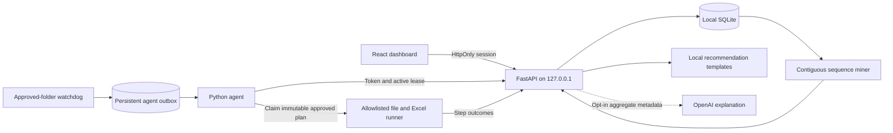

# Architecture and API

`run.py` starts the HTTP service and the Python agent worker together. The agent is its own module and can also run as a separate process; either way, its events and commands go over authenticated loopback HTTP, never a public interface.

## Choices I made, and why

The executive summary left some doors open (plain localhost endpoints, generated Python for execution). I closed both. Every protected API needs a token, and CORS is not treated as authentication. The browser exchanges the local token for a signed 12-hour HttpOnly SameSite=Strict cookie, and origins and hosts are checked explicitly.

Instead of letting a model generate Python, execution is a fixed set of typed actions. AI output explains a pattern; it can never run code, pick files, or grant consent. You fill in concrete inputs, inspect a preview, and approval and execution are separate API calls.

For discovery I went with bounded contiguous sequence mining, one of the options the summary describes. Sessions split on a five-minute inactivity gap or a new file creation after a completed sequence. Noisy repeated saves collapse into one event, and modification noise on non-documents is ignored. Support counts independent sessions, closed patterns suppress redundant fragments, and each session is allocated to one pattern so savings aren't double-counted. It's a deterministic heuristic, not a trained model, and for this MVP that's enough. PrefixSpan and clustering libraries would just add weight.

Windows has a quirk where a cross-folder move can arrive as a delete followed by a create. The watcher correlates stable filesystem identities to recognize those moves without reading file contents. On startup it indexes metadata for up to 50,000 existing files in the approved folders; the live identity cache has the same cap. Moves across volumes, or involving files outside that index, may look like creations. Every path is resolved and checked against the approved scope before anything is scanned.

The initial index runs on a cancellable background thread after the observers start, so folder counts and event delivery don't wait on a big scan. Each scan captures its own scope and cancellation event; a cancelled scan can't write into a newer scope's index even if a slow filesystem call returns after permissions changed. Pausing or changing folders cancels the old scan instead of waiting on disk.

Destination suggestions look at retained real move events and successful runs from the same source folder and file family (all image extensions share a family, so JPEG and PNG examples can teach the same car/bus split). Filename terms are matched against destination folder labels locally; generic words like "image", "copy", or dates are ignored, and conflicting or missing evidence means you get asked to choose. Candidates must be existing folders inside the current approved scope. The review form asks for a suggestion per source file and makes you confirm or edit it; changing the source clears the confirmation. Suggestions are advisory only — preview, approval, and execution keep all their path checks.

## Approval lifecycle

1. Preview validates every path, reads only the selected inputs, extracts optional invoice fields, resolves filename templates, validates the tracker, and snapshots SHA-256 fingerprints. It changes nothing.
2. The immutable plan is stored with a 15-minute expiry and the current folder-permission revision.
3. Approval re-checks the file snapshots and binds a single-use approval to that preview.
4. Execution atomically consumes the approval and inserts a queue item. An agent must be online, and only one automation runs at a time.
5. The agent atomically claims the command, re-checks scope and fingerprints, and reports each step before and after it runs. Scope is refreshed before every step.
6. Rename/move refuse existing destinations. Cross-volume moves use exclusive creation and verify the copy before deleting the source. Excel writes go through a backup and a temporary workbook, verify the original hasn't changed, then replace it atomically.
7. Completion persists the result. A durable outbox on the agent retries reporting without repeating mutations. If an agent disappears, its runs land in `needs_review` and are never replayed automatically.

There's no multi-file transaction or auto-rollback. If step two fails after step one succeeded, step one stays done and shows up in the log. I'd rather have inspectable partial results than a silent, unsafe replay.

## Main endpoints

All bodies are JSON. Everything except health, session pairing/probing, and the API docs requires authentication. Browser routes accept a session cookie or bearer token; agent routes need the bearer token, and active operations also check the `X-IWD-Agent` lease header.

| Method and path | Purpose |
| --- | --- |
| `GET /api/health` | Public liveness response with no private data |
| `GET/POST/DELETE /api/session` | Probe session, pair, disconnect |
| `GET /api/dashboard?source=real` | Overview totals, seven UTC daily buckets, workflows, recent events, agent state |
| `GET/PUT /api/settings` | Approved folders, consent, monitoring, retention, discovery threshold, optional AI |
| `POST /api/events` | One validated event or `{events: [...]}` batch, max 200 |
| `GET /api/events` | `source`, `q`, `kind`, `limit`, and `offset` filtering |
| `DELETE /api/events` | Clear selected activity with `{source, confirm: true}` |
| `POST /api/demo` | Idempotently load labeled sample history |
| `POST /api/analyze` | Run discovery now |
| `GET /api/workflows` | Current discovered workflows for the selected source |
| `POST /api/suggest` | Local or opt-in cloud explanation for `workflow_id` |
| `POST /api/destination` | Suggest scoped destinations for `{workflow_id, source_file}` from local filename and move history; no file changes |
| `POST /api/preview` | Resolve `{workflow_id, params}` into an immutable preview |
| `POST /api/approve` | Approve `{workflow_id, preview_id}` |
| `POST /api/execute` | Queue `{workflow_id, approval_id}` once |
| `GET /api/runs` | Paginated history, plans, step outcomes, backups, errors |
| `POST /api/runs/{id}/cancel` | Cancel an unclaimed queue item |
| `GET /api/status`, `/api/heartbeat` | Agent status |
| `POST /api/agent/heartbeat` | Acquire/renew the single-agent lease |
| `GET /api/agent/config` | Current approved scope and observation settings |
| `GET /api/agent/commands` | Atomically claim the next approved command |
| `POST /api/agent/runs/{id}/progress` | Persist step progress |
| `POST /api/agent/runs/{id}/complete` | Idempotently persist terminal results |

Interactive schemas live at `/api/docs`. The frontend polls active runs every 1.5 seconds and other visible data every 10 seconds; background discovery runs every 15 seconds. The summary mentions WebSockets as optional — polling is fine at this scale.

## Storage and recovery

`iwd.sqlite3` holds settings, events, workflows, explanations, previews, approvals, plans, and run outcomes. `agent.sqlite3` holds unsent events and terminal reports. `token` is the pairing secret, and `backups/<run-id>/` keeps pre-edit workbook copies. All of it lives outside the source checkout by default and is never served by the static-file handler.

Raw event retention is enforced periodically and whenever the retention setting changes. Clearing an activity source deactivates its patterns and expires its previews, but run history and backups stay — deleting those is a deliberate manual step.

Event batches are atomic at the API boundary. If a batch is rejected for bad data, the agent splits it into smaller batches to isolate the bad records; good deliveries are acknowledged on their own and individual rejections bump a dropped-event counter without stopping the watcher. Transport, auth, and lease failures keep events pending, and retries after a lost response are idempotent. Heartbeats use their own HTTP client, and both clients close only after the heartbeat thread stops.

A single-agent lease expires after 20 seconds without a heartbeat; a running command without a heartbeat for 90 seconds becomes `needs_review`. Queue claims and approval consumption happen inside SQLite write transactions. Changing folder scope revokes unconsumed previews and queued commands. Pausing keeps your folder permissions but stops observation; removing a folder revokes access.

Stale-run recovery also runs before enqueue and claim, so a new request doesn't depend on someone visiting the history page or on the next maintenance cycle. Old heartbeat timestamps without a timezone are read as UTC.